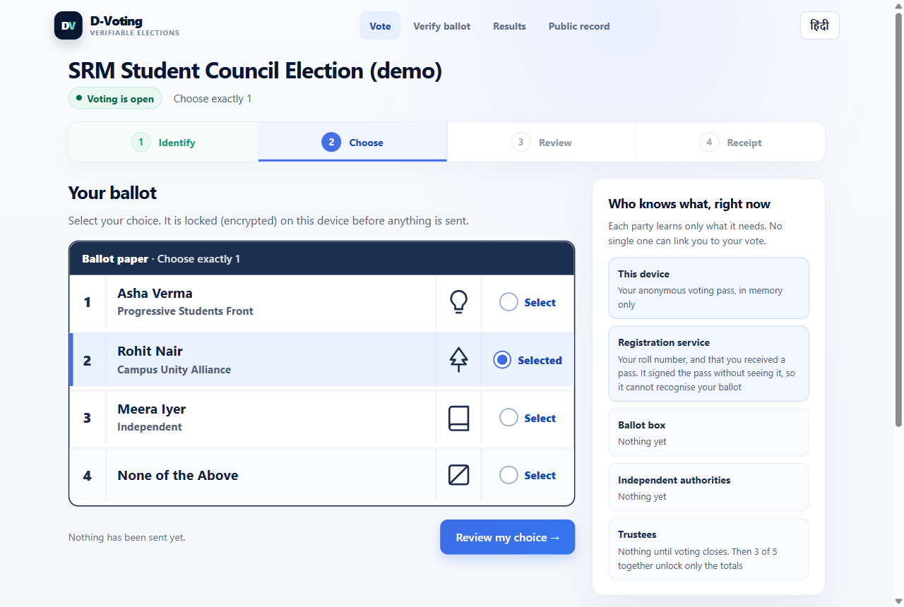
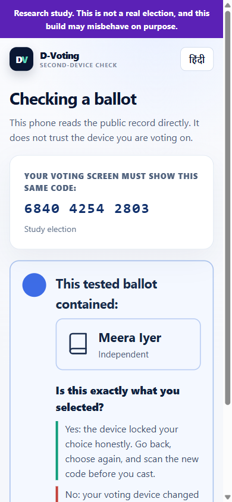
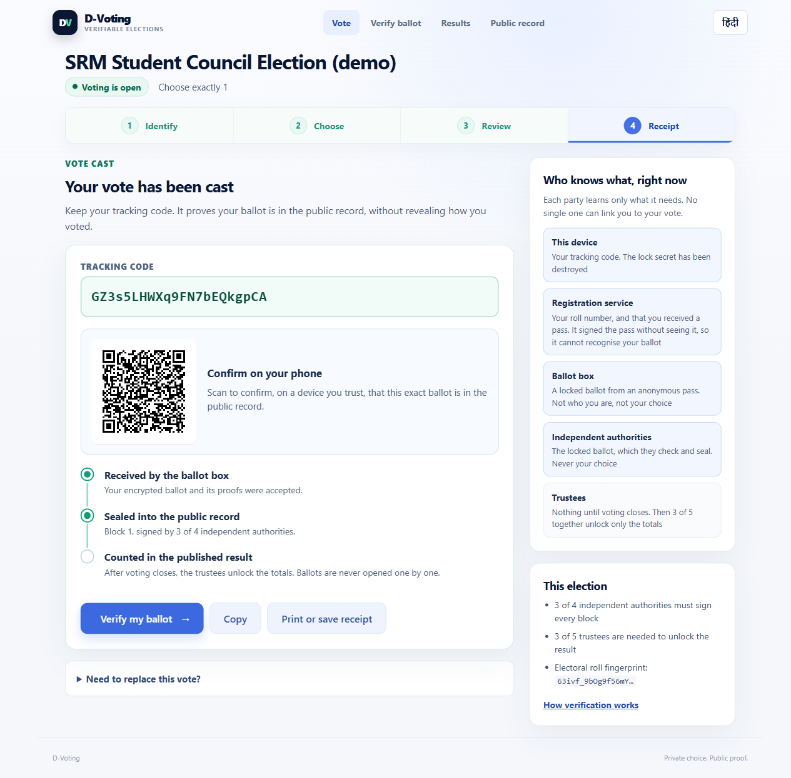
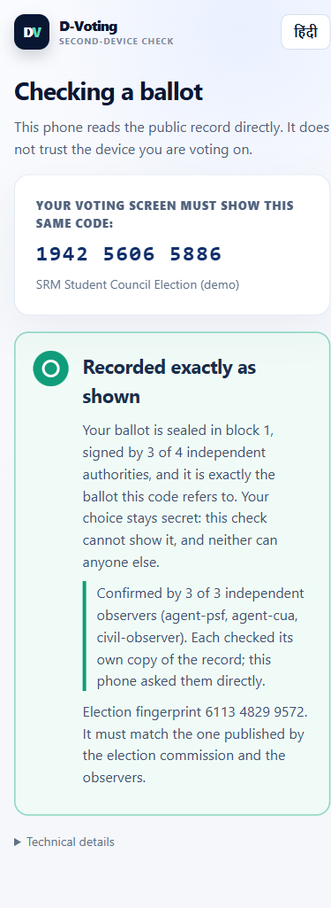
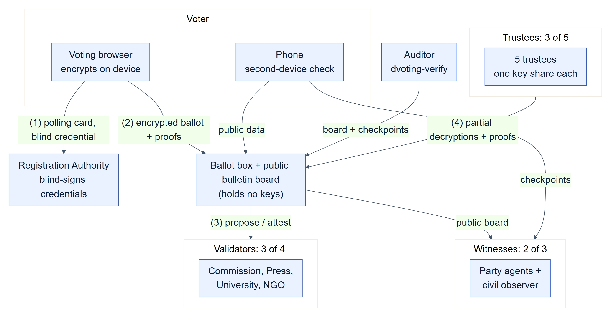
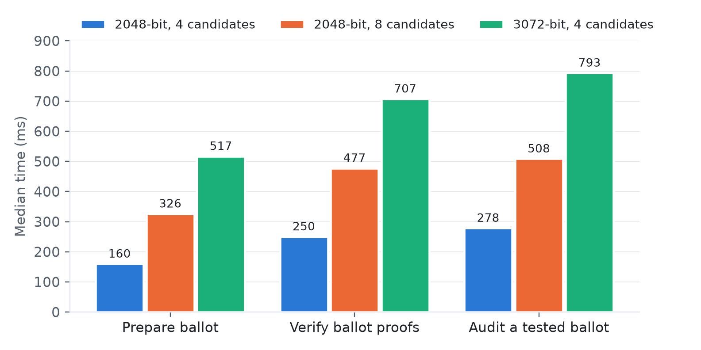

<h1 align="center">D-Voting</h1>

<p align="center">
  <b>End-to-end verifiable electronic voting that an ordinary voter can check —<br/>
  with a phone that audits the ballot, and witnesses that keep the bulletin board honest.</b>
</p>

<p align="center">
  <a href="https://github.com/pranav7368/D-Voting/actions/workflows/ci.yml"></a>
  
  
  
  
</p>

<p align="center">
  <a href="https://d-voting.onrender.com/demo"><b>▶ Try the live demo</b></a> — vote, check your ballot on your phone, and recount the election yourself.<br/>
  <sub>Free hosting: the first visit after a quiet spell takes about a minute to wake the server, and each restart starts a fresh election.</sub>
</p>

<p align="center">
  
  &nbsp;
  
</p>

D-Voting is an end-to-end verifiable voting system. Ballots are encrypted in
the voter's browser; eligibility comes from blind-signed credentials that cannot
be linked to the voter; a permissioned ledger of four validators records every
ballot tamper-evidently; and three of five trustees jointly decrypt only the
totals. Anyone can recount the result from public data.

It goes after the two trust assumptions that survive in most deployed systems:

| Usually trusted | In D-Voting |
|---|---|
| **The voting device checks itself.** The "test this ballot" challenge runs in the same browser that made the ballot, so a compromised one simply reports *passed*. | **A phone checks it.** The review screen shows a QR code *before* the voter decides; the phone reads the sealed ballot from the public record, re-runs the audit itself and names the candidate from the sealed election definition. |
| **The bulletin board is read through the server.** A dishonest server can show one voter a private board on which every check succeeds. | **Witnesses vouch for it.** Party agents and an observer keep their own replicas, refuse to sign any rewrite or fork, and sign checkpoints the voter's device fetches **directly**. A receipt counts only when two of three witnesses' heads are reachable from it. |

## Highlights

- **Cryptography from the standards, no third-party crypto libraries** — RSA blind
  signatures (RFC 9474), exponential ElGamal over RFC 3526 groups, disjunctive
  Chaum–Pedersen proofs with strong Fiat–Shamir, Pedersen distributed key
  generation, 3-of-5 threshold decryption, Ed25519, RFC 6962 Merkle proofs.
- **Second-device ballot checking** of both tested and cast ballots, including a
  voting page that shows a falsified candidate list.
- **Witnessed bulletin board** with split-view detection on the voter's own
  device and omission detection in the auditor's tool.
- **Validators that re-verify every ballot** on their own replica before signing,
  so even a dishonest ballot box cannot get an invalid ballot sealed.
- **A voter interface built for Indian elections** — EVM-style rows with party
  symbols, NOTA, English and Hindi, a 12-digit check code and a receipt timeline.
- **A standalone verifier** (`dvoting-verify`) that recounts an election with none
  of the project's servers involved.
- **583 automated tests**, including end-to-end attacks by manipulated clients,
  split-view boards and stuffed blocks; CI on every push.
- **Deployable** as the full 14-process system, or as a single 70 MB process on a
  free cloud tier.

<p align="center">
  
  &nbsp;
  
</p>

## How it works

<p align="center"></p>

The design is one idea repeated: **no party ever holds two pieces of knowledge
that would let it link a voter to a vote, or produce a result alone.**

| Party | Holds | Learns | Never learns |
|---|---|---|---|
| Voter's device | the choice, credential, encryption randomness | — | — |
| Registration Authority | the issuer key | which roll entry registered | the credential it signed |
| Ballot box | nothing secret | encrypted ballots | who cast them |
| Validators (3 of 4) | one Ed25519 key each | sealed blocks | any choice |
| Trustees (3 of 5) | one key share each | only the totals, jointly | any single ballot |
| Witnesses (2 of 3) | one Ed25519 key each | the board's head | any choice |

1. The commission composes the ballot, freezes the electoral roll and opens the
   poll; opening seals the whole election definition into block 0.
2. The voter proves eligibility with a polling card and receives a blind-signed
   credential the Registration Authority has never seen.
3. The browser encrypts the choice and proves the ballot valid without revealing
   it. The voter may test the ballot on a phone, or cast it and get a tracking code.
4. Validators re-verify the ballot and seal it; witnesses countersign the board.
5. After the poll closes, three trustees decrypt only the homomorphic totals, each
   with a proof. Anyone recounts the published result with `dvoting-verify`.

The blockchain is an **audit and tamper-evidence layer**, not the source of
secrecy or integrity — deliberately, following Park, Specter, Narula and Rivest
(2021), who show that treating a blockchain as the security mechanism for voting
produces undetectable failures.

## Quick start

Requires **Node.js 22.18 or later**. There is no build step for the server, and no
database is needed for the demonstration modes.

```bash
git clone https://github.com/pranav7368/D-Voting.git && cd D-Voting
npm install
npm run build:web   # bundle the crypto library for the browser
npm test            # 583 tests across eight workspaces
npm run demo        # a complete election, narrated, in about 20 seconds
npm run dev         # the full system: 4 validators, 5 trustees, 3 witnesses,
                    # the Registration Authority and the ballot box
```

`npm run dev` prints every console address and token, and deliberately leaves
the election unopened: the commission composes it, freezes the roll and opens it
from `http://localhost:8082/admin`. Voters use `/vote`; the trustees' consoles and
the results page take it from there. [RUNNING.md](RUNNING.md) walks through a
whole election step by step, and [DEMO.md](DEMO.md) is a twelve-minute demonstration script.

Recount any election yourself:

```bash
npm run verify -- --url http://localhost:8082 --witnesses --save board.json
```

## Run it in the cloud

**Live:** [d-voting.onrender.com/demo](https://d-voting.onrender.com/demo) — demo
polling cards, the voting page, ballot verification, the public record and the
results, all from one address.

The whole system also runs as **one process on one port**, which fits Render's
free tier and gets the HTTPS the phone check needs. To deploy your own copy:

1. In the [Render dashboard](https://dashboard.render.com) choose **New → Blueprint**
   and select this repository; Render reads [`render.yaml`](render.yaml) and builds the [`Dockerfile`](Dockerfile).
2. The start-up log prints the public address, the commission token, the trustee
   console links and sample polling cards.
3. Open `/demo` on the public address: it links to every part of an election that
   opens automatically with 200 demonstration voters.

Locally: `node deploy/hosted.ts`, or `docker build -t dvoting . && docker run -p 10000:10000 dvoting`.
Each start is a fresh election with fresh keys. Running every party in one
process demonstrates the protocol, not the independence between the parties.

## Results

Medians on one core of an Intel Core i5-1135G7 laptop, Node 24, without network
latency. Every number is regenerated by `node scripts/bench/evaluate.ts`; the
full tables are in [docs/evaluation/results.md](docs/evaluation/results.md).

| Operation | 2048-bit | 3072-bit |
|---|---:|---:|
| Prepare a ballot on the voter's device (4 candidates) | 160 ms | 517 ms |
| Verify a ballot's proofs (any observer) | 250 ms | 707 ms |
| Ballot-box admission | 201 ms | |
| Seal a block, four validators each re-verifying the ballot | 403 ms | |
| Phone: confirm a cast ballot | 3.35 ms | |
| Phone: re-run a tested ballot's audit | 237 ms | |
| Phone: confirm three witness checkpoints | 5.83 ms | |
| Independent audit, per ballot (recount and witnesses) | 218 ms | |

<p align="center"></p>

A complete ten-ballot election on the hosted deployment was recounted by the
standalone verifier against the live service and its witnesses: every check
passed and the recounted result matched the announced one.

## Testing

Each workspace has its own suite on the Node.js test runner; CI runs the
typecheck, all 583 tests, the browser build and a dependency audit on every push.
Security claims are tested as attacks, with the test playing the adversary:

| Attack | Outcome |
|---|---|
| Voting app encrypts another candidate and lies about its own test | Phone's audit fails; voter warned |
| Voting app shows one ballot's code and casts another | Phone sees a different sealed commitment |
| Voting page shows a falsified candidate list | Phone names the true candidate from block 0 |
| Ballot box shows one voter a private chain | No witness head reachable; receipt not confirmed |
| Board rewrites, forks or rolls back history | Witnesses raise an alarm and stop signing |
| Exported board omits blocks | Verifier detects the gap against witness checkpoints |
| Ballot box stuffs an invalid ballot into a block | Validators refuse to attest |
| Double vote, replayed credential, forged signature or decryption share | Refused |

Building the verification features also exposed six integrity defects that
earlier tests had missed — among them a race that could accept a ballot and then
lose it, and validators that signed blocks without re-checking them. All six are
fixed and guarded by regression tests.

## Security

- The ballot box holds no trustee key shares and no validator keys: there is no
  code path from the commission's console to a plaintext vote or a forged record.
- The election definition, roll commitment and close record live on the chain;
  every service refuses to start if its configuration disagrees with block 0.
- Every page runs under a strict Content Security Policy with no inline script;
  browser bundles are reproducible and their SHA-256 hashes are published.
- Inputs are schema-validated with size limits, secrets are compared in constant
  time, registration is rate-limited, and production dependencies audit clean.

The full list of controls is in [design notes](docs/design-notes.md#security-controls),
and the adversaries, assumptions and residual risks are in the
[threat model](docs/threat-model.md). Not addressed: coercion resistance beyond
re-voting, identity proofing, hardware key custody and post-quantum security.

## Project structure

```
packages/
  crypto/        blind signatures, ElGamal, zero-knowledge proofs, DKG, threshold decryption
  ledger/        canonical encoding, Merkle trees, chain validation, consensus, checkpoints
  verifier/      dvoting-verify: recounts an election from public data alone
services/
  registration/  Registration Authority: electoral roll and blind credential issuance
  ballot-box/    ballot admission, bulletin board, tally, and every web page
  validator/     one validator node: own key, own replica, re-verifies before signing
  trustee/       one trustee: one key share and its console
  witness/       one independent witness: own replica, signed checkpoints
deploy/          single-process hosted mode (Render, Docker)
scripts/         development launcher, browser build, evaluation harness
docs/            design documents, threat model, evaluation results
```

## Documentation

| Document | What it covers |
|---|---|
| [Architecture](docs/architecture.md) | Parties, data flows and diagrams |
| [Threat model](docs/threat-model.md) | Adversaries, assumptions, residual risks |
| [Cast-as-intended checking](docs/cast-as-intended.md) | The Benaloh challenge and the second-device check |
| [Witnessed bulletin board](docs/witnesses.md) | Checkpoints, split views, the election fingerprint |
| [Registration and blind signatures](docs/registration-and-blind-signatures.md) | Credentials, the electoral roll, limitations |
| [Ballot encryption and tallying](docs/ballot-encryption-and-tallying.md) | ElGamal, proofs, homomorphic tally |
| [Threshold key generation](docs/threshold-key-generation.md) | Pedersen DKG and threshold decryption |
| [Ledger and bulletin board](docs/ledger-and-bulletin-board.md) | Blocks, consensus, Merkle proofs |
| [Election lifecycle](docs/election-lifecycle-and-administration.md) | What the commission can and cannot do |
| [Voter interface](docs/frontend-design.md) | Design decisions and the research behind them |
| [Literature review](docs/literature-review.md) | Related systems and research |
| [Design notes](docs/design-notes.md) | Why blind signatures, performance work, security controls |
| [API reference](docs/api.md) | Every HTTP endpoint |
| [Evaluation results](docs/evaluation/results.md) | Every measured number and the machine it came from |

## Tech stack

TypeScript on Node.js (native type stripping, no transpiler between review and
execution) · Hono · Zod · WebCrypto and native BigInt · PostgreSQL for the
Registration Authority in production · esbuild for the browser bundles · Docker ·
GitHub Actions.

## About

D-Voting was built by **Pranav Kumar Singh** as an M.Tech (Computer Science and
Engineering, Full Stack) project at SRM Institute of Science and Technology,
Kattankulathur, under the guidance of **Dr. Kavi Priya D**. A research paper on
second-device ballot checking and witnessed bulletin boards is in preparation;
the project report and paper are available on request.

© 2026 Pranav Kumar Singh. All rights reserved. The source is published for
review and evaluation; no licence to reuse it is granted.
